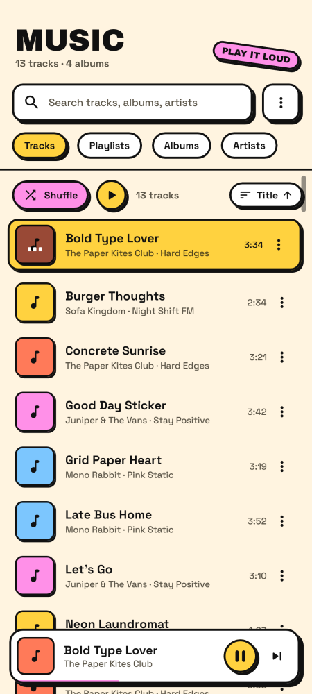
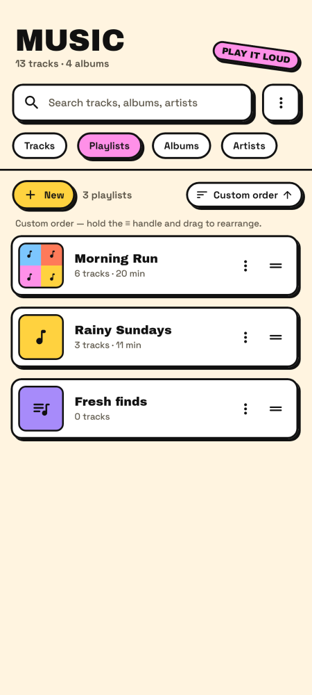
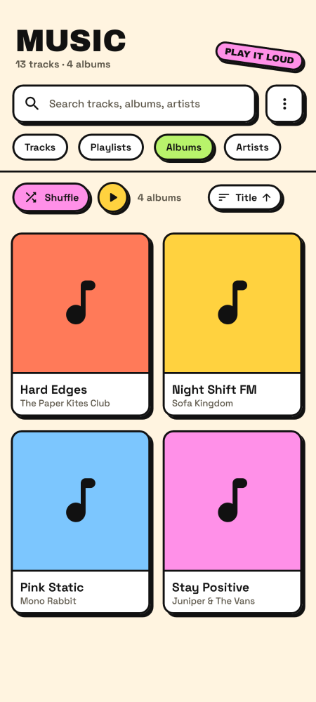
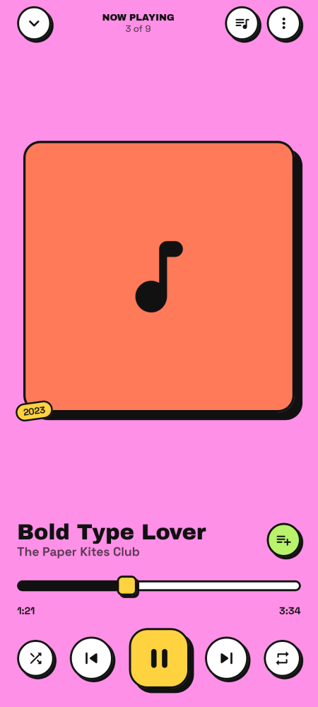
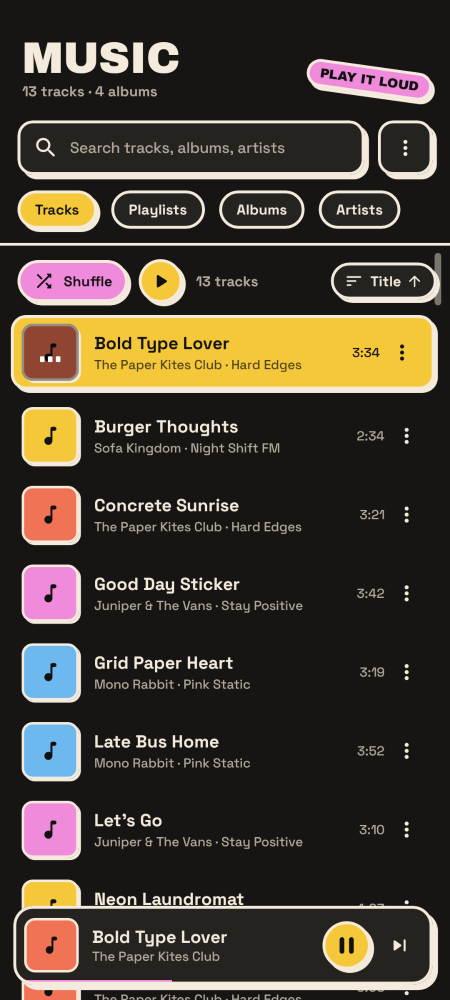

# Neo Music

An offline music player for Android with a **neubrutalist** look (flat bold colors, thick outlines, hard offset shadows) and a Samsung Music–style flow.

| Tracks | Playlists | Albums | Now playing | Dark |
|---|---|---|---|---|
|  |  |  |  |  |

## Features

- **Home with 4 tabs** — Tracks, Playlists, Albums, Artists. Swipe left/right to switch tabs. The large "MUSIC" title collapses as you scroll, One UI style.
- **Tracks**: Play all, Shuffle, sort by title / artist / album / date added / duration / year (ascending or descending).
- **Playlists**: create, rename, delete. Sort by name, date created, date modified, track count, or **Custom order** (drag the ≡ handle to rearrange playlists). Each playlist page has a cover, Play, Shuffle, an "Add tracks" picker (with confirm buttons at the top and bottom), and its own sort, including a custom drag-to-reorder track order.
- **Playlist covers**: tap the cover (or ⋮ → Change cover) to pick a photo from your gallery, use one of the playlist's album covers, or go back to the automatic 2×2 mosaic.
- **Fast scroll bar** on every list: drag the handle on the right edge to jump through long lists. A bubble shows where you are (first letter, year, etc., following the current sort).
- **Albums** (grid) and **Artists** (list), each with a detail page: cover, Play and Shuffle buttons.
- **Track ⋮ menu** everywhere: Add to playlist · Album · Artist · Delete · Track details. Inside a playlist there's also Remove from playlist.
- **Track details**: title, artist, album, duration, record date, full file location, plus folder, format, size, bitrate, sample rate, genre and date added.
- **Global search** across tracks, albums and artists (ignores case and accents).
- **Mini player** at the bottom: tap it or swipe up to open Now Playing, swipe sideways to skip.
- **Now Playing**: minimize button at the top left, or swipe down to minimize. Seek bar, shuffle, repeat (off / all / one), swipe the cover to skip, queue view (tap to jump, × to remove, drag to reorder).
- Background playback with a media notification, lock-screen and Bluetooth controls (Media3). Pauses when headphones are unplugged.
- **Light / Dark / System theme** (⋮ menu on the home screen).

## Build

Requirements: JDK 17+, the Android SDK (platform 35), or simply Android Studio.

```bash
cd NeoMusic
./gradlew :app:assembleRelease      # -> app/build/outputs/apk/release/app-release.apk
```

The release build is signed with the debug key so it installs directly. Use your own signing config before publishing to a store.
Pushing changes under `NeoMusic/` also builds the APK on GitHub Actions. Download it from the workflow run's artifacts.

### Screenshot tests

The screenshots above are rendered on the JVM with [Paparazzi](https://github.com/cashapp/paparazzi) using fake library data:

```bash
./gradlew :app:recordPaparazziDebug   # re-render into app/src/test/snapshots
./gradlew :app:verifyPaparazziDebug   # fail if the UI changed
```

## Code map

| Path | What |
|---|---|
| `data/` | MediaStore scanning (`MusicRepository`), playlists as JSON (`PlaylistStore`), prefs, models and sorting |
| `playback/` | `PlaybackService` (Media3 `MediaSessionService` + ExoPlayer), `PlayerConnection` (controller → state flows) |
| `ui/theme/` | Neubrutalist tokens: colors (light/dark), borders, shadows, type (Archivo Black + Space Grotesk) |
| `ui/components/` | `NeoBox` (outline + hard shadow + press effect), buttons, chips, menus, dialogs, track row, artwork loader |
| `ui/screens/` | Home + tabs, album/artist/playlist pages, search, track details, track picker |
| `ui/player/` | Mini player, Now Playing, seek bar, queue |
| `ui/AppRoot.kt` | Navigation, player sheet gestures, dialogs, delete flow |

Fonts are under the SIL Open Font License (see `licenses/`).
